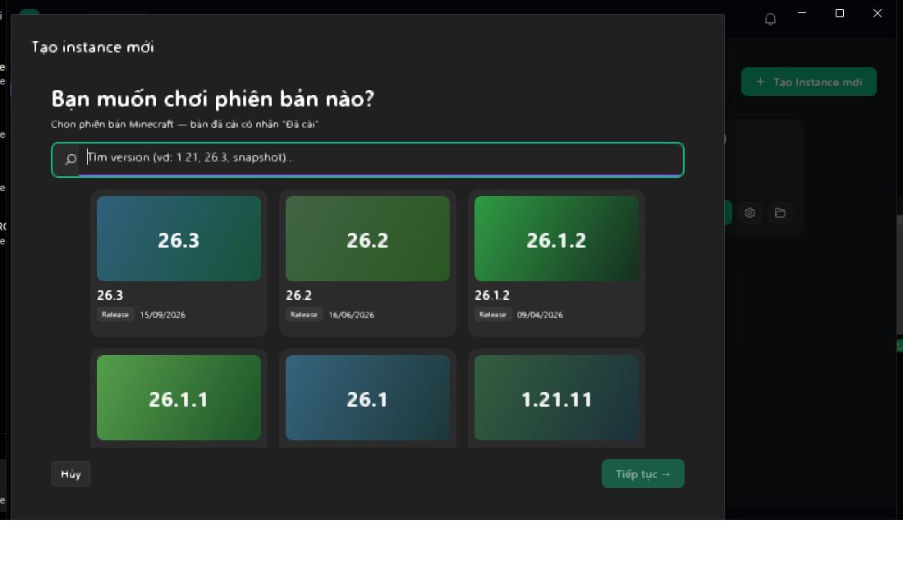
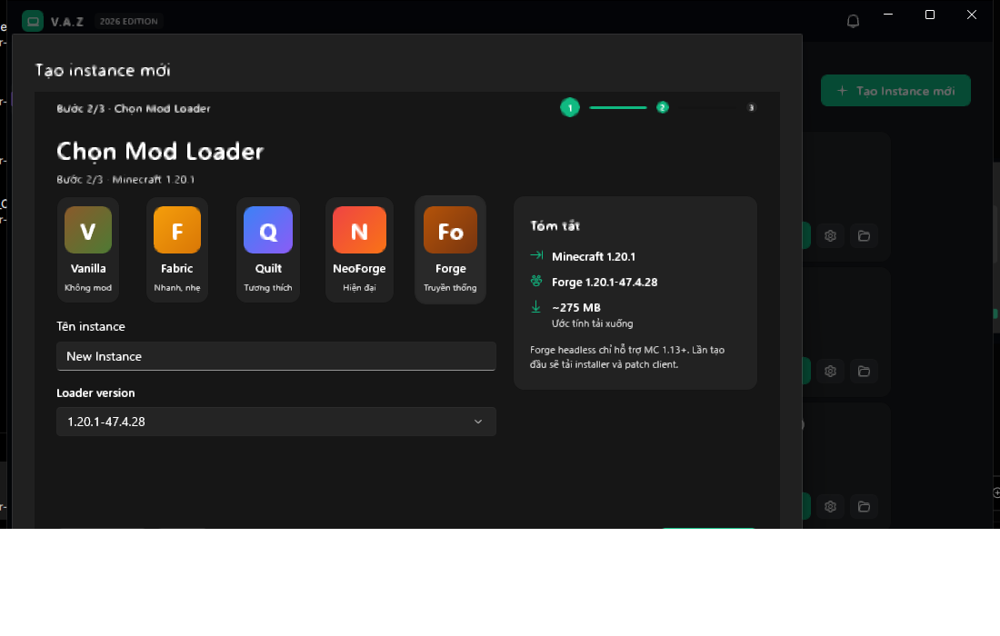
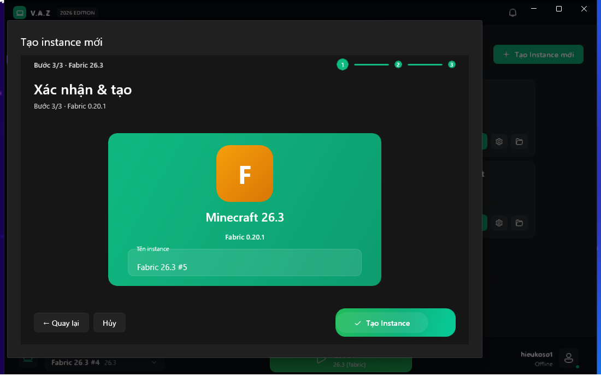
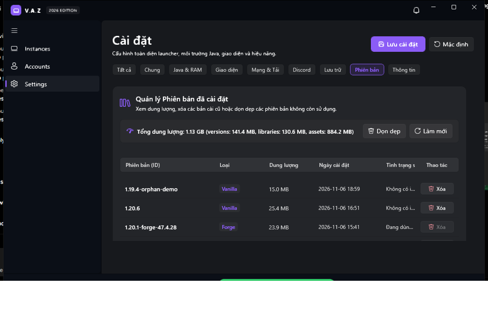

# Vazer Launcher (`Vaz`) — v0.19.0

Standalone Minecraft launcher + mod management project, extracted from the
`UltraPcOptimizer` solution. This repository is fully independent — it has no
project reference to, and no dependency on, UltraPcOptimizer.

**Current release:** `v0.19.0` (2026-11-10) ·
[CHANGELOG.md](CHANGELOG.md) · 493/493 tests · 0 build warnings.

## Highlights

- **Five loaders**: Vanilla, Fabric, Quilt, NeoForge and Forge (headless ≥ 1.13),
  plus OptiFine installer support.
- **Resource Packs & Shaders Manifest & Persistence**: Dedicated manifest storage
  (`resourcepacks.json` & `shaderpacks.json`) with auto-migration, offline thumbnail
  caching, and persistent "Installed" state across app restarts.
- **Unified Install UX & Feedback**: Real-time progress bar for Resource Pack downloads,
  rich media toast notifications with cover/gallery images for Shaders.
- **3-step Create Instance wizard**: version cards with real covers + search,
  loader/version selection and an animated confirm step.
- **Change Version in-place**: switch Minecraft version + loader on an existing
  instance with backups, keep/delete mods choice and rollback on failure.
- **Version Management**: Settings tab with installed versions, disk usage stats
  and orphan cleanup.
- **Java compatibility**: automatic Java 8 / 17 / 21 mapping per MC version,
  installed-JDK detection in Settings, Java 22–25 support and non-blocking
  mismatch warnings (never auto-downloads Java).
- **Mods & modpacks**: Modrinth search/install with dependency resolution,
  `.mrpack` import, resource packs, shaders, worlds, logs and notifications.

## Screenshots

| Create Instance — Step 1 | Create Instance — Step 2 |
| --- | --- |
|  |  |

| Confirm & create | Version Management |
| --- | --- |
|  |  |

More screenshots, videos and verification reports: [docs/evidence/](docs/evidence/),
especially [dot18](docs/evidence/dot18/) and [dot19](docs/evidence/dot19/).

## Layout

```
Vaz.sln
├── src/Vazer.Core           # Core domain library (launcher + mod logic)
├── src/Vaz.WinUI            # WinUI 3 desktop app (MVVM)
├── tests/Vazer.Core.Tests   # xUnit suite (463 tests)
├── tests/web-e2e            # Playwright runtime tests for the web prototype
├── docs/                    # Contracts, feature docs, design tokens, evidence
├── website/                 # Skin viewer site
├── CHANGELOG.md             # Release history
├── Directory.Build.props    # Shared analyzer / nullable settings
└── appsettings.json         # Sample runtime configuration
```

## Vazer.Core

| Area | Folder | What it does |
| --- | --- | --- |
| Accounts & auth | `Abstractions/`, `Auth/`, `Store/` | Microsoft (MSAL) auth, offline/demo auth, account persistence |
| Instances | `Instances/` | Create, list, update, delete, in-place change-version with rollback |
| Java runtime | `Java/` | Adoptium API lookup + local JRE resolution (8–25) and MC→Java mapping |
| Launch | `Launch/` | Game process launch (CmlLib) + Java compatibility warnings |
| Loaders | `Loaders/` | Vanilla / Fabric / Quilt / NeoForge / Forge / OptiFine installers |
| Versions | `Versions/` | Mojang + loader metadata, semantic comparison, installed-version management |
| Mods | `Mods/`, `Modrinth/` | Modrinth search/install, dependency resolution |
| Modpacks | `Modpacks/` | `.mrpack` import |
| Markdown | `Markdown/` | Lightweight markdown parser used for mod descriptions |
| DI | `Extensions/` | `AddMinecraftLauncher(...)` registration extension |

## Build & test

```powershell
dotnet build Vaz.sln              # 0 warning, 0 error
dotnet test  Vaz.sln              # 463/463 pass
.\scripts\check.ps1 -Scope static # build + test + agent config gate
npm run check:web                 # Playwright gate (needs npm install + chromium)
```

## Using the library

```csharp
using Microsoft.Extensions.DependencyInjection;
using Vazer.Core.Extensions;

var services = new ServiceCollection();
services.AddMinecraftLauncher(opt =>
{
    opt.RootPath = @"%APPDATA%/Vazer/Minecraft";
    opt.OfflineDemoMode = true;
});

var provider = services.BuildServiceProvider();
var launcher = provider.GetRequiredService<IGameLauncher>();
```

## Configuration

`MinecraftOptions` defaults live in `src/Vazer.Core/MinecraftOptions.cs`; data is
stored under `%APPDATA%/Vazer/Minecraft` by default. Copy `appsettings.json` next
to your host executable and bind the `Minecraft` section to override.
`MinJavaVersion = 8`, `MaxJavaVersion = 25`.

> Microsoft sign-in requires your own Azure AD application client id
> (`MsalClientId`). Leave `OfflineDemoMode` on for local development.

## Known limitations

- Intel HD 4600 (2016 driver) cannot reach the game menu on this test machine;
  Forge/Fabric launch verification is GPU-dependent.
- Legacy Forge ≤ 1.12.2 is intentionally blocked (artifacts live on a separate
  legacy Maven layout).
- `instance.json.bak` / `mods.json.bak` are kept after Change Version for manual
  recovery; no automatic cleanup yet.

See [CHANGELOG.md](CHANGELOG.md) for the full list.

## UI prototype (web)

Bản demo giao diện chạy trên browser để chỉnh spacing/bố cục trước khi port sang
WinUI: `docs/design-preview/` (mở `index.html`, không cần build).
Chi tiết: [docs/design-preview/README.md](docs/design-preview/README.md).
